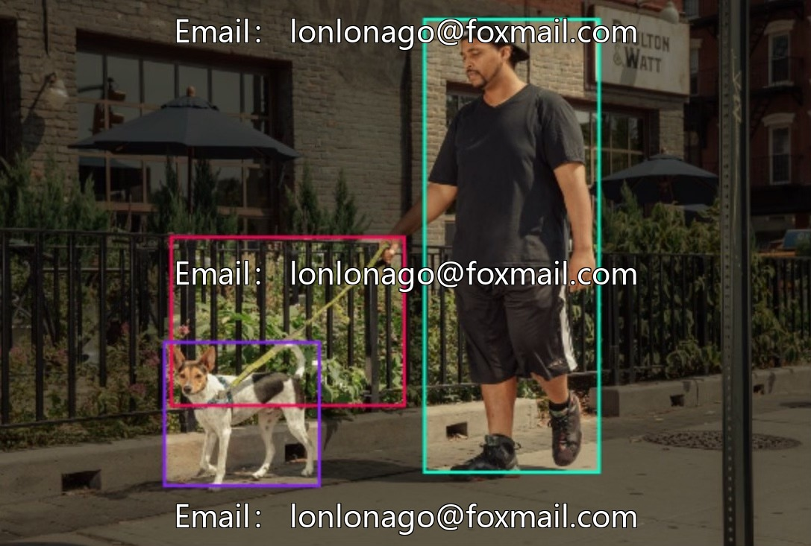
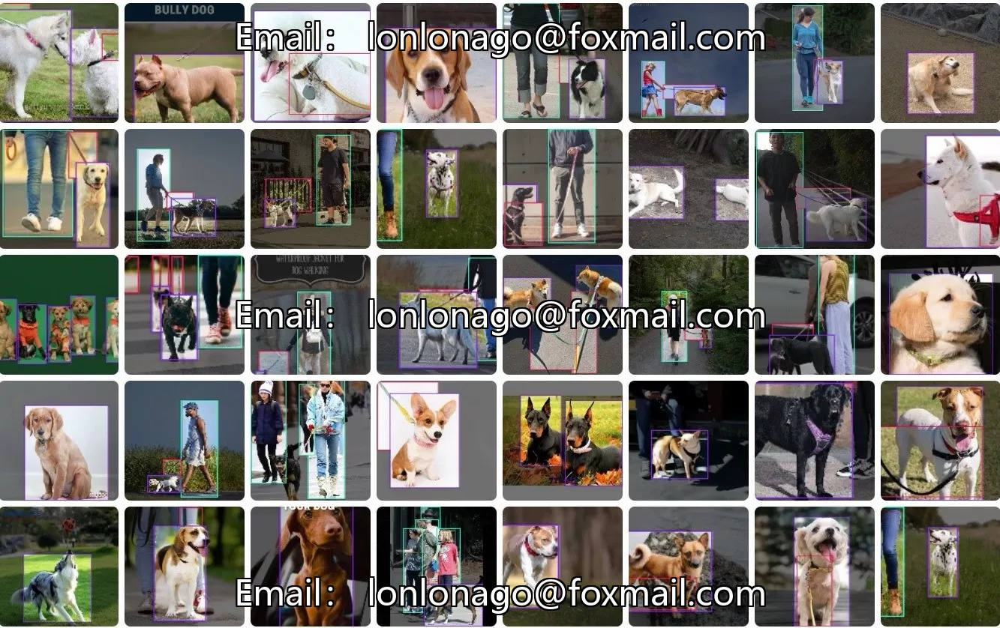
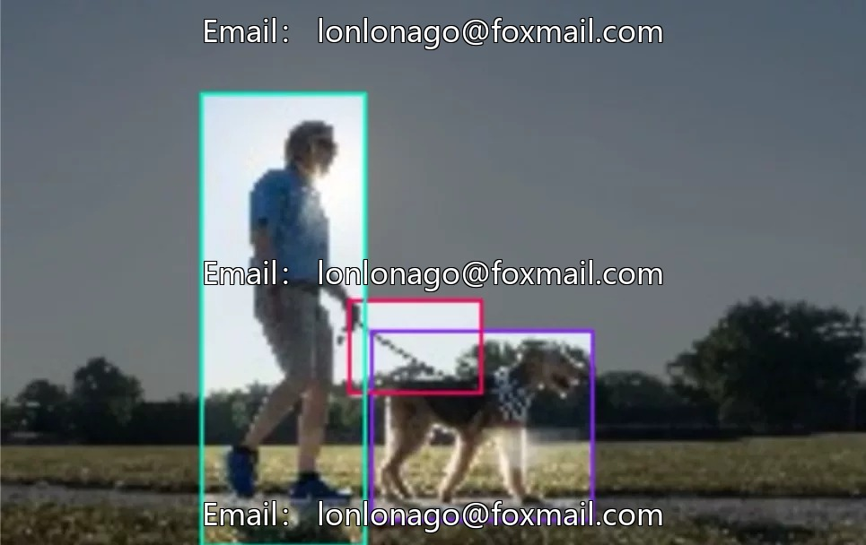
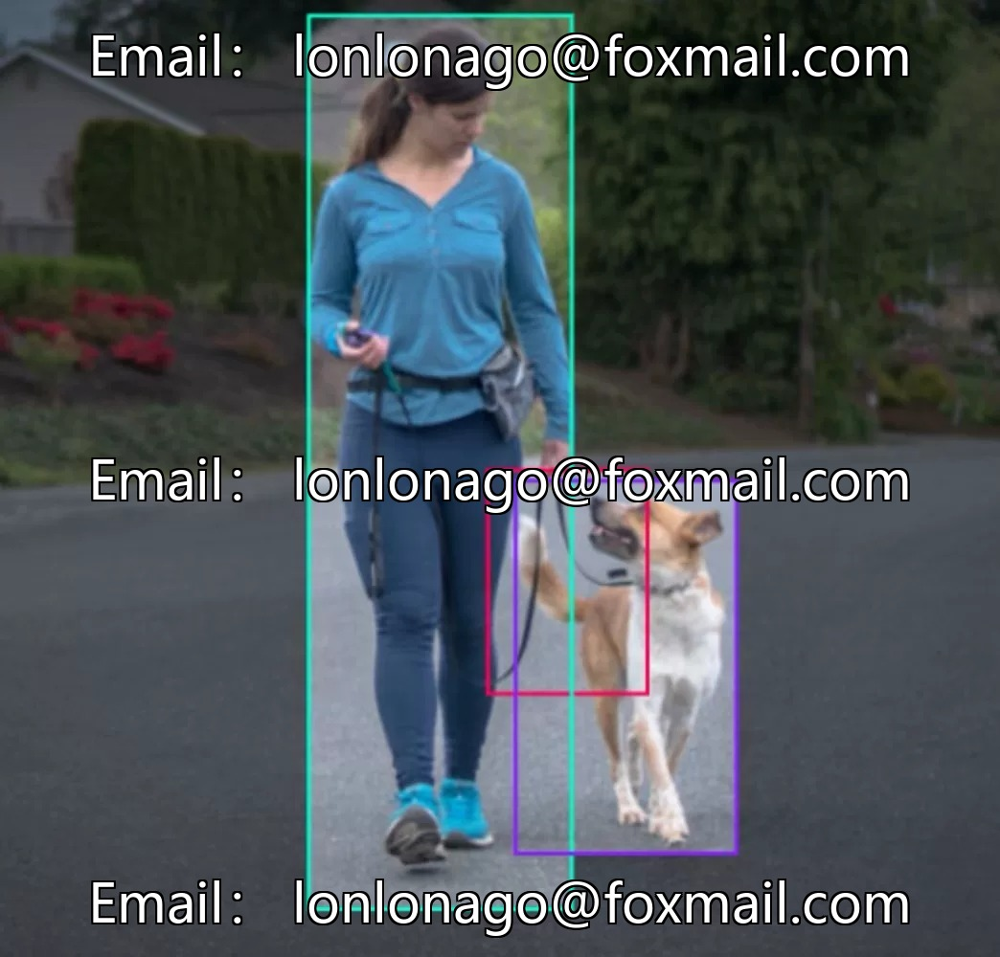
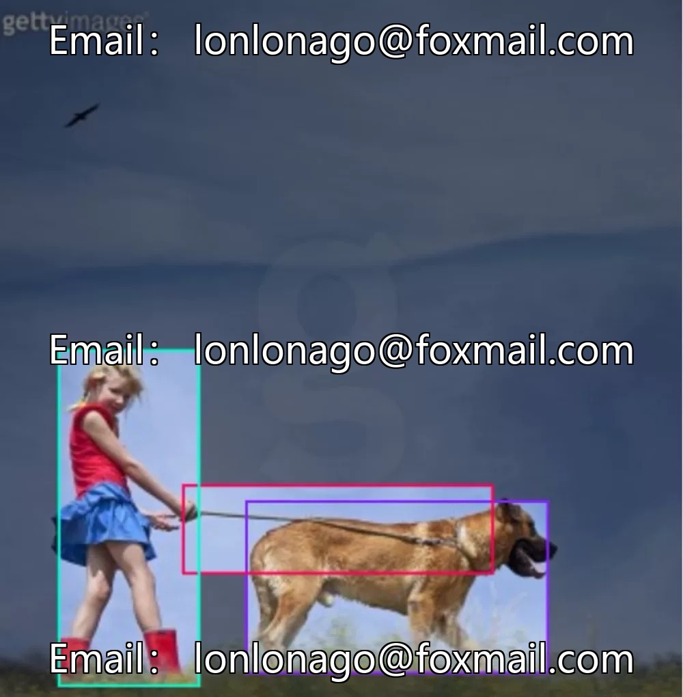

# Dog leash detection dataset

## Body

Dog leash detection dataset for smart city, public area dog regulation management, dog safety monitoring, pet management scene recognition, dog leash detection, dog detection 10379th issue

The dataset consists of 4 categories: Dogs, Dog Collar, Dog-Collar, Human, with a total of 1000 image data in YOLO format. It is suitable for training target detection models in the context of pet management, the development of public area dog regulation algorithms, and data support for dog safety monitoring systems.

Data coverage includes core recognition scenarios such as not leashing dogs, with a complete set of categories for dogs, people, and dog leashes, meeting practical application needs.

Virtual materials, once sold, are non-refundable.
Interested friends, click "I want" to proceed.

## Images

## Payment

Here is a pay link on Stripe ( https://buy.stripe.com/3cs8yP7sY87d0vu9AB ). Please contact me lonlonago@foxmail.com after funding $89, and I will send you a complete data files , thank you!

